# Smile ID iOS SDK, the Swift package

The Swift Package Manager distribution of the **Smile ID iOS SDK**: identity verification flows for
your SwiftUI app.

<picture>
  <source media="(prefers-color-scheme: dark)" srcset="assets/readme/spm-install-dark.svg">
  
</picture>

## Install

```swift
.package(url: "https://github.com/smileidentity/ios-spm", from: "12.2.0")
```

| Product | For |
|---|---|
| `UseSmileID` | the SDK. Start here; it brings in `UseSmileIDBridge` |
| `UseSmileIDVisionFace` | the Apple Vision face analyzer, optional |
| `UseSmileIDVisionDocument` | the Apple Vision document analyzer, optional |

iOS 15 or later · Swift tools 6.0 · built with Xcode 27.1

## Docs and releases

The [Smile ID documentation](https://docs.usesmileid.com) has the integration guides.
[Releases](https://github.com/smileidentity/ios-spm/releases) lists every version. A snapshot is
for testing only, and the `snapshot` branch follows the newest.

MIT licensed. See [LICENSE](LICENSE).
